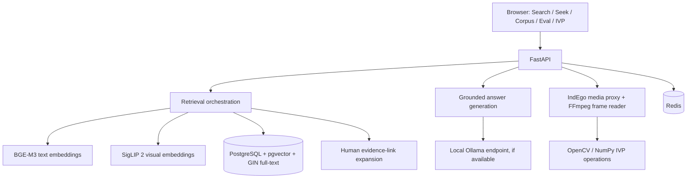

# TRACE — Three-Course Project Master Handoff

**Project title for a shared report:** *TRACE: A Multimodal Manufacturing Evidence Search and Real-Video Analysis System*
**Prepared:** 26 November 2026 (Asia/Calcutta)
**Courses:** Image and Video Processing (IVP), Intelligent Model Design (IMD), Applications of AI
**Use:** Send this file with the project ZIP to Claude as the factual source for a report and Gamma-ready presentation. It is intentionally more detailed than a normal report: it includes both report-safe wording and technical notes for project mastery.

> **Evidence rule for any generated report/slides:** distinguish implemented, historically evaluated, currently runnable, prepared-but-disabled, and future work. Do not convert a design plan or a development-set result into a current product claim.

## 1. One project, three academic viewpoints

TRACE is one system with three useful course lenses. Keep the central project story consistent; emphasize different parts for each course.

| Course | What TRACE contributes | What to emphasize | Boundary to state |
|---|---|---|---|
| Image and Video Processing | Real-video frame reading and classical image/video analysis | Color spaces, contrast, filtering, edges, morphology, local features, HOG, keyframe selection, optical flow, and timestamped real-video source frames | These are generic visual-processing operations. TRACE is not a defect detector or a learned action-recognition system. |
| Intelligent Model Design | Selection and integration of pretrained text, image, and language models into a measurable system | BGE-M3 text embeddings, SigLIP 2 image embeddings, model dimensions, separate retrieval lanes, rank fusion, grounded generation, ablations, and evaluation design | Foundation models were used off the shelf. No model was trained or fine-tuned. Optional AI captions/ASR and query reranking are not active. |
| Applications of AI | A practical multimodal RAG application for industrial evidence discovery | Search across video moments, keyframes, manuals, SOPs, and inspection reports; evidence links; citations; timestamp seeking; abstention | It is a research/demo prototype, not a production safety system, live camera monitor, or automated maintenance decision-maker. |

**Recommended shared title:** *TRACE: Multimodal Retrieval-Augmented Question Answering for Manufacturing Evidence, with Real-Video Image and Video Processing.*

## 2. Executive project summary

TRACE is a local-first manufacturing evidence search prototype. It helps a user search a curated corpus of manufacturing videos, still images/keyframes, technical manuals, SOPs, and inspection reports. It retrieves timestamped video segments and document passages, uses human-authored links to connect related evidence, and presents sources that a person can inspect. The IVP studio separately exposes classical OpenCV analyses on real frames and short windows from the IndEgo dataset.

The engineering contribution is the system design and integration: modality-specific representations, dense and lexical retrieval, timestamp-aware evidence, PostgreSQL vector/full-text storage, curated cross-modal links, grounded answer handling, and an interactive interface. The system is not based on a newly trained foundation model.

### Report-ready abstract

> TRACE is a multimodal manufacturing evidence search prototype that connects real manufacturing video moments with keyframe images and technical document passages. Its curated corpus contains 25 IndEgo videos, timestamped segments, 114 keyframes, 28 technical documents, and 154 human-authored evidence links. The system uses text and visual embeddings, PostgreSQL dense and lexical retrieval, rank fusion, heuristic temporal refinement, and a grounded answer interface with source citations. A separate web-based IVP studio processes real source frames using classical OpenCV methods, including color-space transformations, contrast analysis, filtering, edge detection, local features, keyframe selection, and optical flow. Recorded live checks verified real-frame decoding and a short-window analysis on source video. Evaluation met the recorded document Recall@5 and answer-faithfulness targets; video segment Recall@5 remained below target, and several held-out criteria remain unestablished. Optional AI captioning and speech transcription code is prepared but disabled and has not produced corpus outputs.

## 3. Problem, users, and intended workflow

Manufacturing evidence is split across videos, maintenance records, procedures, and manuals. Searching these independently makes it difficult to locate the moment an operation occurs and verify it against written requirements.

TRACE’s motivating query shape is:

> “Find the video where the hydraulic pump was inspected and tell me what problem was identified.”

The intended workflow is:

1. Retrieve likely video segments or whole videos from the natural-language query.
2. Refine a coarse segment into a timestamped span.
3. Retrieve related document chunks and optionally keyframes.
4. Expand through curated evidence links where appropriate.
5. Present answer claims with evidence identifiers and allow users to inspect the video/document source.

The project scope excludes live camera ingestion, defect classification, model training, sensor/PLC integration, and production safety decisions.

## 4. Corpus, data provenance, and what “caption” means

### Corpus snapshot

The recorded PostgreSQL corpus snapshot contains:

| Item | Count | Notes |
|---|---:|---|
| IndEgo videos | 25 | 4.60 hours total; 4 equipment families |
| Video segments | 1,205 | 114 manually annotated keysteps + 1,091 derived 30-second windows |
| Technical documents | 28 | 7 manuals, 14 SOPs, 7 maintenance/inspection reports |
| Document chunks | 67 | Structure-aware sections with page/section metadata where available |
| Keyframes | 114 | Workpiece frames associated with manual keysteps |
| Evidence links | 154 | Human-authored cross-modal relations |
| Evaluation queries | 206 | 111 development and 95 locked-test queries |
| Dense vectors | 1,386 | Historical index count across the project’s text and visual vector tables |

The public source is Fraunhofer IPK’s IndEgo dataset, pinned by the web application manifest to revision `c822468b5e0c9c42ebbf2939d3be936c2b203704`. The project manifest records CC BY 4.0. The catalogue count is not a claim that every video was processed during the IVP demonstration.

### The corpus counts, explained from zero

Think of the corpus as a carefully organized library. A video is a book, a segment is a marked passage in that book, a keyframe is a picture of one moment, and a document chunk is a small section cut from a manual so it can be searched.

- **25 videos (4.60 hours):** the source recordings in the registered IndEgo catalogue. A catalogue entry tells the app where a source video is and its metadata. It does not mean all 25 were downloaded into the project folder or analyzed in one batch.
- **1,205 segments:** timestamped ranges that search can return. Of these, **114 are manually annotated keysteps** (human-marked actions) and **1,091 are derived fixed 30-second windows**. The two types are not interchangeable: one is a human task annotation, the other is a convenient search window. Their counts add to 1,205.
- **114 keyframes:** still images associated with the manually annotated keysteps. A keyframe is a representative frame, not a full video and not automatically a complete visual summary.
- **28 documents:** 7 manuals, 14 standard operating procedures (SOPs), and 7 inspection/maintenance reports. These are the written evidence collection.
- **67 document chunks:** searchable passages made by dividing documents into smaller pieces while retaining section/page clues. A chunk is not a new document.
- **154 evidence links:** human-authored connections between items. The four labels mean “related document,” “states a specification,” “depicts this evidence,” and “contradicts this evidence.” The counts 85 + 41 + 16 + 12 = 154. They were curated by people; the system did not discover or verify them automatically.
- **206 evaluation queries:** 111 development questions used while building/tuning and 95 locked-test questions intended for final checking. “Locked” means the test set should not guide tuning; the final report must disclose exactly which test results exist.
- **1,386 dense vectors:** numeric lists stored to support similarity search across text and visual items. This is an old recorded index count, not the number of videos, generated captions, or models. A vector is like a location on a many-dimensional map; nearby vectors are treated as more similar.

Keep these units separate: **asset** = registered source item; **segment** = timed part of a video; **keyframe/image** = still image; **chunk** = passage of a document; **link** = curated relationship; **vector** = searchable numeric representation; **query** = evaluation question. Counts differ because one video can have many segments, and one document can have multiple chunks.

“Caption” needs special care. Here it usually means human IndEgo keystep wording or text assembled from existing metadata/annotations for a window. BGE-M3 turns existing text into vectors; it does not look at pixels and invent a description. Optional vision caption and speech-to-text paths have not generated and indexed outputs for this corpus.

### Caption and transcript provenance

- Existing video text is IndEgo human keystep annotation and text constructed from metadata/annotations for fixed windows.
- Existing text was vectorized for semantic search. **Vectorization does not generate a caption.**
- There is no completed vision-language-model caption generation for the existing video corpus.
- There are no pipeline-generated Whisper transcripts or word timestamps in the current indexed corpus.
- Do not call the human keystep labels “Whisper transcripts” or “AI-generated captions.”

### Remote media handling

The IVP reader accesses real IndEgo media through a same-origin proxy and decodes selected frames/windows into bounded memory buffers. The recorded IVP frame response used `Cache-Control: no-store`. No complete video collection was copied into the repository for this workflow. MinIO media storage and the arq ingestion worker are deferred; the default ingest route is not a complete live ingestion pipeline.

## 5. Architecture and design



### Components

- **FastAPI** — API validation, search orchestration, application pages, IVP endpoints, generation, and SSE streaming.
- **PostgreSQL 16 + pgvector** — assets, segments, chunks, images, evidence links, vector tables, and metadata.
- **PostgreSQL GIN full-text index** — lexical document search.
- **Redis 7** — queue/cache infrastructure in the local stack.
- **BGE-M3** — historical local text encoder for video-segment/window text and document chunks; vectors are 1,024-dimensional.
- **SigLIP 2 SO400M** — historical local visual encoder for keyframes and visual lanes; vectors are 1,152-dimensional.
- **Ollama** — local language model HTTP interface. Runtime success must be checked at demo time. The local inventory last checked contained `llama3.2:3b` (text-only); it is not a vision captioner.
- **Browser UI** — `/` and `/demo/seek` for search/seek, `/corpus` for assets, `/eval` for scorecard/ablations, `/ivp` for the real-video IVP studio, and `/docs` for OpenAPI.
- **Docker Compose** — API, database, Redis, and migration service. MinIO/worker use a deferred `media` profile and are not part of the normal default run.

### Model and retrieval design

1. **Text query embedding:** BGE-M3 maps a query to a dense 1,024-dimensional vector.
2. **Video text retrieval:** dense search over existing annotated segment/window text.
3. **Document retrieval:** BGE-M3 dense ranking plus PostgreSQL GIN full-text ranking.
4. **Rank fusion:** document dense and lexical result lists use Reciprocal Rank Fusion (RRF, `k=60`). RRF adds reciprocal rank contributions rather than blending uncalibrated raw scores.
5. **Visual retrieval:** SigLIP 2 embeds images/keyframes; historical visual-caption fusion used a 50/50 visual/semantic balance in the image retrieval evaluation.
6. **Evidence expansion:** PostgreSQL links can expand results to connected items, with relation provenance retained.
7. **Temporal refinement:** coarse intervals can be narrowed with lexical overlap against annotated captions/action clauses and a sliding-window heuristic. It is not a learned visual temporal-localization model.
8. **Generation:** retrieved evidence is assembled into citation-bearing items. The generator is designed to answer from these items and abstain on insufficient evidence. The API citation validator checks citation IDs against IDs retrieved for the request; it does not alone establish semantic entailment.

**Important search boundary:** the current main search path combines video text retrieval, hybrid document retrieval, and link expansion; image search is also available. Do not claim a universal four-lane RRF fusion of all video, document, image, and visual-segment streams.

## 6. Image and Video Processing (IVP) implementation

The standalone page at `/ivp` uses actual IndEgo source footage, not the CAD reconstruction. Its pipeline is:

1. Load the source-video catalogue.
2. Select a video and timestamp or short interval.
3. Read remote media through TRACE’s proxy.
4. Decode selected frames with FFmpeg into memory.
5. Apply OpenCV/NumPy operations.
6. Return images, measurements, timestamps, and motion/keyframe outputs to the page.

The interval analysis code caps a request at 90 seconds and at 24 frames; sampling is clamped to 0.25–4 frames/second. This is an on-demand dataset demo, not live camera processing.

### Implemented operations

| Operation | Implementation / teaching explanation |
|---|---|
| Color spaces | RGB, grayscale, HSV, and LAB conversion; useful for separating luminance from color information. |
| Histograms and contrast | B/G/R and grayscale histograms, grayscale histogram equalization, and CLAHE on the LAB lightness channel. |
| Filtering | Gaussian blur at multiple kernel sizes, sharpening kernel, emboss kernel, and Laplacian response. |
| Edges | Sobel x/y gradients, magnitude/direction, and Canny edge detection. |
| Morphology | Thresholding, erosion, dilation, opening, closing, morphological gradient, top-hat, black-hat. |
| Keypoints | SIFT and ORB keypoint/descriptor visualizations. |
| HOG | Histogram of Oriented Gradients visualization. |
| Keyframes | Mean grayscale inter-frame difference threshold plus minimum time gap; selected frames also carry Canny edge density and Laplacian-variance sharpness. |
| Optical flow | Sparse Lucas–Kanade and dense Farneback flow on adjacent frames. |

**Synthetic-flow caveat:** the single-frame backend function can create a translated companion frame to demonstrate optical flow. The IVP UI omits this synthetic single-frame flow. The segment/window endpoint computes motion from consecutive source-video frames; show that endpoint when claiming real-video motion.

### Live IVP evidence recorded 26 November 2026

- `/ivp` returned HTTP 200.
- A media proxy range request returned HTTP 206 from a pinned IndEgo MP4.
- The live catalogue returned 25 videos.
- `/api/v1/ivp/frame` decoded a real 480-pixel-wide frame at 23.76 seconds; PNG response size was 233,400 bytes with IndEgo provenance and `Cache-Control: no-store`.
- One selected frame returned eight technique results in 234.9 ms.
- One real eight-second interval sampled 16 frames, selected 3 keyframes, and returned optical-flow images and motion metrics.

These are a selected-frame and selected-window demonstration, **not a dataset-level accuracy benchmark or p95 latency result**. Browser rendering/button interaction was not separately exercised in that recorded live check.

## 7. Database model and evidence graph

Important relational tables in `backend/app/models.py`:

| Table | Role |
|---|---|
| `remote_sources` | Registered remote provenance: repository, pinned revision, path, license, category, duration, and verification metadata. This is not a claim that the media was copied into object storage. |
| `assets` | Registered video, image, and document metadata. |
| `segments` | Video intervals with timestamps, method, optional caption/human caption, verification metadata, and transcript field. |
| `chunks` | Document passages with type, section path, page range, text, and token count. |
| `images` | Keyframe/image metadata, source, caption/OCR fields, and links to assets/segments. |
| `evidence_links` | Human-authored relations between a segment, chunk, and/or image with confidence, author, and note. |
| `stage_status` | Processing-stage status, input hash, error, and update time. |

Vector tables include `vec_segment_text`, `vec_chunk`, `vec_image`, and `vec_segment_visual`; they are queried with pgvector cosine distance and HNSW indexes. Document lexical retrieval uses a GIN-indexed text search field. The project’s history reports 1,386 total dense vectors.

### Evidence-link relation counts

| Relation | Count | Purpose in the curated corpus |
|---|---:|---|
| `documents` | 85 | Connects evidence to related document material |
| `specifies` | 41 | Connects a documented specification to an action/item |
| `depicts` | 16 | Connects an image or description to depicted evidence |
| `contradicts` | 12 | Records conflicting/deviating evidence |

These are curated human links, not relations predicted by a graph neural network.

## 8. User interfaces and APIs

### Every page and screen, explained for a first-time user

The website is a small web application served by FastAPI. The main screens are tabs inside one HTML application shell, not four separate frontend applications. The links `/`, `/demo/seek`, `/corpus`, and `/eval` can lead to that same shell; the selected tab determines what is shown. `/ivp` is a separate page. A URL name alone does not prove that its page has a separate implementation.

1. **Dashboard** (`/`, Dashboard tab): the front door. It gives a short project overview and buttons to begin a search or open the corpus inventory. It is a navigation/summary screen; it is not itself an experiment result.
2. **Search and Seek** (`/demo/seek`, Search and Seek tab): enter a question in ordinary language. The system searches available lanes and can show ranked video moments, written passages, images, and evidence connections. A result can open a video and move its playhead to a timestamp. The goal is to help a person find and inspect evidence. Availability and quality of live semantic lanes depend on their model services being reachable; an old index count does not prove that a model service is running now.
3. **Corpus Inventory** (`/corpus`, Corpus Inventory tab): browse registered videos/documents and related segments, chunks, images, and links. Think of it as the catalogue and evidence map. The catalogue is not a claim that every remote media object was copied locally.
4. **Engineering Compliance** (`/eval`, Engineering Compliance tab): show the engineering specification/Definition of Done and evaluation/ablation material. It is a scoreboard against stated targets, not a certificate that every target passed. Use the gate-by-gate explanation below and quote status and sample size together.
5. **Diagnostics drawer** (gear/Diagnostics button in the main header): provides technical trace/diagnostic details such as which steps or evidence were involved. It is for explaining/debugging the pipeline, not a guarantee that every optional service ran.
6. **Visual Intelligence Studio** (`/ivp`, Visual Studio link): choose a real IndEgo video and timestamp, fetch a real source frame, run classical image-processing operations, or analyze a short video interval. The interval view samples source frames and can show selected keyframes and optical-flow/motion outputs. The recorded live check verified API outputs; browser-side button-by-button rendering was not separately exercised. A single-frame analysis is not motion analysis; motion needs successive real frames.
7. **API documentation** (`/docs`): FastAPI’s automatically generated endpoint reference. It is useful to developers and is not intended as a presentation page.
8. **Health and readiness** (`/healthz`, `/readyz`): operational checks. Health answers “is the API process answering?” Readiness checks whether required dependencies are ready. A healthy process does not prove optional embedding or generation services are connected.

### What the main user journey does

Imagine asking, “Where is the pump inspection, and what does the procedure say?” The search screen sends the question to retrieval; retrieval finds candidate timed video passages and written chunks; optional curated links connect items; the interface shows evidence and timestamps. The user then opens the video/document and checks it. “Retrieval-Augmented Generation” (RAG) means a language model is given retrieved passages before composing an answer. A citation lets the reader jump to evidence, but a citation label alone does not prove the wording is correct. Judge-scored faithfulness and manual source inspection are separate checks.

### Pages

| Page | Local URL | Use |
|---|---|---|
| Search and seek | `http://localhost:8000/` or `/demo/seek` | Natural-language search, evidence display, timestamp seeking, citation interactions. Requires relevant retrieval/LLM services for full behavior. |
| Corpus explorer | `/corpus` | Browse registered assets, segments, documents, keyframes, and evidence links. |
| Evaluation dashboard | `/eval` | View stored scorecards and ablation/evaluation results. |
| Visual Intelligence Studio | `/ivp` | Display real IndEgo source frames and run classical IVP analyses. This is the most robust presentation path when model servers are unavailable. |
| API documentation | `/docs` | FastAPI OpenAPI/Swagger UI. |
| Health/readiness | `/healthz`, `/readyz` | Process health and service readiness. |

### Main endpoint families

- `GET /api/v1/status` — service/corpus status.
- `GET /api/v1/assets`, `/api/v1/assets/{id}` — corpus assets/details.
- `POST /api/v1/search` — retrieval.
- `POST /api/v1/generate` and `GET /api/v1/generate/stream` — grounded answer and SSE streaming.
- `GET /api/v1/ivp/catalog` — video catalogue.
- `GET /api/v1/ivp/frame` — decode/return a frame from a real IndEgo source timestamp.
- `POST /api/v1/ivp/analyze` — analyze an uploaded frame.
- `GET /api/v1/ivp/analyze-frame` — analyze a selected real source frame.
- `GET /api/v1/ivp/segment` — analyze a real short source-video interval, including keyframes/motion.
- `POST /api/v1/ivp/enrich` — optional local caption/ASR route; disabled by default and not ready for presentation claims.
- `GET /api/v1/media/proxy` — same-origin remote media proxy for browser playback and decoding.

## 9. Evaluation and honest results

### Words used by the engineering gates

- A **gate** is a checkpoint: a list of things that must be true before a stage is called done.
- **Definition of Done (DoD)** is the agreed checklist for saying the project meets its engineering goals. A screen existing is not proof that its accuracy target passed.
- **Development (dev) set** is practice material used while improving the system. **Locked test set** is the exam kept aside until final evaluation. A dev score is not a substitute for a test score.
- **Recall@5** asks: “For how many questions did at least one correct answer appear among the first five results?” If 19 of 30 questions succeeded, Recall@5 is 19/30 = 63.3%.
- **Temporal Intersection over Union (IoU)** compares the time span found with the correct time span. It is the overlap divided by the total span covered by either one. 1.0 is a perfect match; 0 is no overlap.
- **Faithfulness** asks whether the answer’s factual claims are supported by the evidence supplied to it. It is not the same as writing style, and it does not establish that every fact in the source corpus is true.
- **p95 latency** is the time below which 95 out of 100 complete user requests finish. An average response time cannot prove a p95 limit.
- An **ablation** is a controlled comparison: switch one system component off/on and see whether results change. If two configurations are actually the same, they cannot demonstrate the value of different components.
- **Cohen’s kappa (κ)** measures how much two raters agree after accounting for agreement that could happen by chance.

### Section 1.4: the six final acceptance targets

These are the six headline Definition-of-Done targets. The latest recorded audit meets **2 of 6**. “Not established” means the required evidence is missing; it does not mean the metric is zero.

| Gate, in everyday words | Required proof | Recorded evidence | Plain status |
|---|---|---|---|
| Find the right video moment in the first five results | Segment Recall@5 ≥70% on locked test | 19/30 = 63.3%; dev was 88.5% on n=26 | **Not met:** test result is below target. |
| Point to approximately the right time | Mean temporal IoU ≥0.40 on held-out data | 0.7477 on dev n=26; locked-test value absent | **Not established:** practice score exists, exam score does not. |
| Find the right manual passage | Document chunk Recall@5 ≥80% | 100% across 15 document queries, three runs | **Met in recorded evaluation.** |
| Keep answer claims supported by evidence | Faithfulness ≥85% | 90.4% on 30 multi-hop test items, three runs | **Met in recorded evaluation.** |
| Show multimodal search helps beyond text-only | Positive lift on held-out multi-hop queries | +46.7 percentage points on dev n=30; no held-out lift reported | **Not established:** practice-set improvement only. |
| Finish the complete user request quickly | Full-loop UI p95 <5,000 ms | Mean 381.1 ms recorded; p95 absent | **Not established:** average is not the required slow-tail measure. |

### Engineering phase gates from the build specification

This is a second checklist. A phase gate checks whether the building blocks for the next step exist. “Met (recorded)” means the documented evidence satisfies that threshold; it does not prove every later production property.

| Phase | What it is building | Specification exit gate in plain language | Recorded status |
|---|---|---|---|
| 0 — Linked corpus | Gather source material and map items together. | ≥20 videos ingested/segmented/text-described/embedded, ≥25 docs, ≥100 human links, ≥120 split/locked questions, license notes complete. | **Count thresholds met; full gate not independently established:** 25 videos are registered, with segment/window records and historical vectors; 28 docs, 154 links, 206 queries, and license notes are recorded. These counts do not prove every video passed each ingest stage. IVP live checks covered selected frames/windows, not batch analysis of all videos. |
| 1 — Whole-video retrieval | Find which recording is probably relevant. | Dev Recall@5 ≥0.60 plus a reproducible report and metric checks. | **Met historically:** whole-video Recall@5 96.2% in Phase 1 report. Test suite last recorded 160 passed on 2026-10-24; not rerun for this handoff. |
| 2 — Time-specific retrieval | Find the useful part inside a recording. | Dev mean IoU ≥0.40, R@1 with IoU≥0.3 ≥0.50, segment Recall@5 ≥0.60, and a UI that seeks to the time. | **Partial:** dev IoU 0.7477 and timestamp/seek UI are recorded; locked-test segment Recall@5 is 63.3%, and all specified temporal gate evidence is not recorded as passed. |
| 3 — Image retrieval | Search by visual content as well as text. | Visual dev Recall@5 ≥0.60 and an image evaluation report. | **Development threshold met:** visual dev Recall@5 90% (n=20); final report separately records locked-test visual Recall@5 40%. FORGE was explicitly removed from scope by the user on 2026-10-24; it is **waived/dropped**, not a blocker, and TRACE must not claim FORGE-equivalent results. |
| 4 — Document retrieval | Search manuals/reports by meaning and exact words, with source clues. | Dev doc-only Recall@5 ≥0.80; compare hybrid with dense-only and BM25-only. | **Threshold met in recorded results:** 100% doc Recall@5 on 15 queries and 100% dev hybrid Recall@5; keep the stated sample size and report comparisons honestly. |
| 5 — Combine evidence and answer | Bring video and documents together; cite sources and abstain when needed. | Dev faithfulness ≥0.80, correct abstention ≥7/10, reject citations not in retrieved evidence. | **Partially evidenced:** faithfulness recorded at 90.4% on held-out multi-hop items; separate abstention subset 10/10. Code includes citation-ID validation. Do not say every factual claim is independently proven or every sub-gate received a fresh test. |
| 6 — Evaluate carefully | Compare design choices fairly and report uncertainty. | Run all 11 ablations on test three times with confidence intervals, human-check judge agreement, report §1.4 targets. | **Not complete to spec:** A6 is a fixed 1.1 score multiplier, A7 omits planned LLM reranking/query analysis, A8 duplicates A7, raw per-query results were not archived, and locked-test/CI coverage is incomplete. Judge spot-check: 93.3% agreement (28/30), κ=0.8667. |
| 7 — Presentation interface | Make it usable and show the evidence trail. | Six end-to-end scenarios, clean manual QA, and a rehearsed ten-query demonstration. | **Partial / not fully verified:** search, inventory, evaluation and IVP screens exist; real IVP frame/window endpoints were checked. The six E2E scenarios, complete manual QA and ten-query rehearsal are not evidenced as all passing. |

### Whole-project checklist in Section 18 of the engineering spec

1. **Corpus size and types:** counts recorded as 25 videos, 28 manuals/SOPs/reports, and manual excerpts. Verify the exact “15–30 manual excerpts” sub-count from the source table before claiming that exact item is met.
2. **At least 100 human links:** 154 recorded; met by count.
3. **120–180 questions, split, and test protection:** 206 total (111 dev + 95 locked test); count/split recorded. Do not tune on locked test.
4. **All 11 configurations, three test runs, confidence intervals:** not fully evidenced; see ablation limitations.
5. **Human/judge agreement:** 28/30 agreement and κ=0.8667 recorded; met for that spot-check, with its sample size and scope disclosed.
6. **Section 1.4 headline targets:** only 2/6 met in the recorded held-out summary; one below target and three not established.
7. **Complete UI p95 under five seconds:** not established; mean exists but p95 does not.
8. **End-to-end suite, golden retrieval, CI green:** historical suite result exists, but tests were not freshly run for this handoff. Do not say the current commit is green without a fresh run.
9. **Final report states caveats before results:** the current audit and this handoff list limitations; keep that order in the report.
10. **README explains corpus, circularity, and non-goals:** inspect the README before asserting every item; this handoff states the non-goals and provenance.
11. **Demo rehearsed with fallback recording:** no completion evidence in the status log. Rehearse on the actual presentation machine and keep screenshots/recording as fallback.

“Circularity” means accidentally testing on material that helped build or tune the system. If the same human links or development queries guide configuration choices and are later treated as an independent final exam, results may look better than they generalize. Keep dev and locked-test roles distinct and disclose overlap/limitations.

Evaluation reports are historical artifacts, most recently audited on 26 November 2026. The final held-out acceptance summary is:

| Section 1.4 criterion | Target | Recorded evidence | Status |
|---|---:|---:|---|
| Video segment Recall@5 | ≥70% | 63.3% (19/30) locked test; dev 88.5% (n=26) | **Below target** |
| Document chunk Recall@5 | ≥80% | 100.0% (15 document queries across 3 runs) | **Met** |
| Answer faithfulness | ≥85% | 90.4% (30 multi-hop test items, 3 runs) | **Met** |
| Temporal IoU | Mean ≥0.40 | 0.7477 on dev (n=26); locked-test value not reported | **Not established for held-out** |
| Lift over text-only | Positive held-out delta | +46.7 percentage points on dev (n=30); held-out lift not reported | **Development only** |
| Full-loop UI latency | p95 <5,000 ms | Three-run mean 381.1 ms; p95 not reported | **Not established** |

**Overall:** 2/6 Section 1.4 held-out targets met; video Recall@5 was below target; three criteria lack the specified held-out evidence. Abstention was 10/10 in a separate unanswerable subset; it is not one of these six acceptance criteria.

Other task-specific results:

- Whole-video Recall@5: 96.2% in the Phase 1 report.
- Keyframe visual Recall@5: 90.0% on visual development queries (n=20); the final report’s locked-test table records 40.0% visual Recall@5.
- Document hybrid retrieval: development Recall@5 100.0%, MRR@20 0.9333.
- Judge spot-check: 93.3% agreement (28/30 atomic verdicts), Cohen’s κ=0.8667.
- Historical test suite: 160 passed, last recorded 24 October 2026; not freshly run for this handoff.

### Ablation caveats

- The runner has 11 labels A0–A10, but the code does not implement every intended specification component.
- A6 is a fixed 1.1 linked-segment score multiplier, not a cross-encoder/reranker.
- A7 omits the specified local LLM reranker and query-analysis path; A8 duplicates A7. Do not claim A7/A8 prove query-analysis effects.
- A5/A4’s top-5 paired change is −3.3 percentage points, p=0.3598; it does not establish a significant top-5 improvement.
- The +46.7pp runner-vs-text-only comparison is development-only and does not establish held-out lift.
- Raw per-query ablation scores were not archived for independent recomputation in the later audit.

## 10. Implementation status: complete, prepared, and not done

### Implemented and evidenced

- Core multimodal corpus and PostgreSQL/pgvector schema.
- Real IndEgo source catalogue, proxy playback, real frame decoding, and short-window IVP analysis.
- Classical CV operations listed in Section 6.
- Text embeddings and image embeddings in the historical corpus indexes.
- Dense video/document search, hybrid dense+lexical document retrieval with RRF, visual retrieval, and human evidence-link expansion.
- Heuristic temporal refinement and timestamp-seeking UI.
- Grounded generation path, citation ID validation, streaming interface, corpus explorer, evaluation page.
- Offline evaluation harness and ablation runner (with the design/code caveats above).

### Prepared but disabled / not end-to-end verified

- Local VLM captioning and faster-whisper ASR adapters; `/api/v1/ivp/enrich` returns in-memory results in code but is disabled by default.
- Query rewrites, local LLM candidate reranking, visual/text segment RRF variants, and timed-ASR refinement behind flags defaulting off.
- The host project `.venv` now has `faster-whisper==1.2.1`, `ctranslate2==4.9.1`, and resolved dependencies; `pip check` passed. This install is not in the API container and does not mean ASR is available in the web app.
- No Whisper `large-v3` weights and no Qwen vision weights were downloaded or loaded. No AI-generated transcript/caption results were produced.
- Newly prepared adapter functions passed AST parsing and an offline mocked smoke check, not a model-backed end-to-end run.

### Not implemented / deferred / not a claim

- Defect/anomaly classification and automatic safety/compliance judgments.
- Live camera ingestion, PLC/sensor/ERP integrations, production multiuser operations.
- Full MinIO + arq media ingestion integration; deferred. Do not imply new media uploads are fully ingested/indexed by the default stack.
- VLM captions or Whisper transcripts for existing corpus; generated-output persistence or re-indexing.
- Training/fine-tuning of BGE-M3, SigLIP 2, Llama, Whisper, or a reranker.
- Complete semantic proof of every generated claim; citation-ID validity and judge-scored faithfulness are different checks.

## 11. Hardware, local models, OneDrive, and why the AI pilot is paused

Several environment records disagree and should not be merged into one claim:

1. The historical evaluation report records an NVIDIA RTX 4050 Laptop GPU with 6 GB VRAM.
2. Current user-provided Windows Task Manager screenshots show Intel Iris Xe integrated graphics using shared system memory. A later screenshot showed memory at 75%; a live host counter showed 3,060 MB available at that time.
3. The current WSL Docker GPU probe failed because no GPU adapter was exposed. The API container’s OpenCV 5.1.0 reports `cv2.ocl.haveOpenCL() == False` and `cv2.ocl.useOpenCL() == False`.
4. The ASR package set is installed only in the host `.venv`; the API Docker image/runtime is separate.

Therefore:

- Do not claim the current presentation laptop is the RTX 4050 benchmark machine unless verified.
- CUDA is not usable on the Intel Iris Xe. The current API container also cannot use OpenCL.
- The optional ASR/VLM model pilot has not been run. High RAM use and the lack of a verified accelerator path made model loading unsafe for the presentation deadline.
- Large weights would normally be stored in local user model caches outside the OneDrive repository path; moving the repository does not add RAM or create GPU support.
- Docker’s WSL guidance recommends keeping bind-mounted source under the Linux filesystem for better filesystem performance. This may improve I/O compared with a Windows/OneDrive path, but it is unrelated to the WSL GPU-adapter failure. Do not move the working project right before class.
- No paid API, token, or credit usage is part of the approved project plan. Keep the $0 cost boundary.

Official technical references: [Docker WSL filesystem guidance](https://docs.docker.com/desktop/features/wsl/best-practices), [Docker GPU support on Windows](https://docs.docker.com/desktop/features/gpu/), [OpenVINO supported Intel GPU hardware](https://docs.openvino.ai/2026/about-openvino/release-notes-openvino/system-requirements.html), [OpenCV OpenCL UMat/Transparent API](https://docs.opencv.org/4.0.0/db/dfa/tutorial_transition_guide.html).

## 12. How to start the project after Docker has been closed

These commands start the **core app**. They do not promise that embedding services or Ollama are ready. The IVP page is the most independent demo surface because its classical processing does not need BGE/SigLIP inference.

### Before starting

1. Open Docker Desktop and wait until its engine is running.
2. Open PowerShell.
3. Change directory to the project root:

```powershell
Set-Location 'C:\Users\Shruti Pandey\OneDrive - BENNETT UNIVERSITY\trace-main'
```

4. Start/build the Compose core stack:

```powershell
.\scripts\dev.ps1 up
```

The script runs `docker compose up --build -d`. It starts the Compose services declared for the default profile, including migrations, PostgreSQL, Redis, and API. MinIO/worker are in the deferred `media` profile, not default.

### Check status and readiness

```powershell
.\scripts\dev.ps1 status
Invoke-RestMethod http://localhost:8000/healthz
Invoke-RestMethod http://localhost:8000/readyz
```

Then open:

- `http://localhost:8000/ivp` — real-video IVP demo.
- `http://localhost:8000/docs` — API documentation.
- `http://localhost:8000/` — search/seek application (requires its model endpoints for full retrieval).
- `http://localhost:8000/corpus` and `/eval` — corpus and evaluation pages.

If startup fails, inspect:

```powershell
.\scripts\dev.ps1 logs
```

If Docker is not in PowerShell’s PATH, `scripts/dev.ps1` checks standard Docker Desktop install locations. First startup may need network access to build/pull container images. Do not use `docker compose down -v`; `-v` can delete the persistent PostgreSQL data volume.

### Stop without deleting the database

```powershell
.\scripts\dev.ps1 stop
```

This stops Compose services and preserves volumes. Docker Desktop itself can remain open or be exited separately after the containers stop.

### If `/ivp` opens but search fails

That is consistent with the last recorded audit: API, PostgreSQL, and Redis had been healthy, but API requests to BGE (`host.docker.internal:8001`) and SigLIP (`:8002`) returned connection refused. Search also depends on those services. Do not download models during class preparation; show `/ivp` and explain search’s local model services are a separate runtime requirement.

The historical README lists model-server commands, but the caches were previously inspected and the BGE/SigLIP weights were absent from the standard cache. The scripts can fetch model IDs when caches are empty. Only start them when you are intentionally setting up the model runtime, have enough resources, and approve the downloads. Current Intel/WSL hardware path differs from the historical RTX/CUDA setup.

## 13. Demo script for tomorrow

### Reliable IVP-first path

1. Start Docker and core services using Section 12.
2. Open `/ivp`; choose a catalogue video and a time.
3. Show that the selected frame is from real IndEgo source footage.
4. Run one or two spatial techniques (for example, LAB/CLAHE and Canny edges).
5. Select a short interval and show keyframes/timestamps.
6. Show optical flow from the interval endpoint and say it estimates apparent pixel motion between adjacent source frames.
7. State clearly that captions are dataset annotations; AI-generated captions and ASR are future/optional work.

### One-minute narrative

> “TRACE connects industrial video moments with images and technical documents so a user can find and verify relevant evidence. The IVP studio reads real IndEgo frames and demonstrates classical image processing, threshold-based keyframe selection, and optical flow on a short interval. The larger system also includes pretrained text/image embeddings, hybrid document search, evidence links, temporal seeking, and grounded answers. On the locked test, document retrieval and answer faithfulness met their targets; video segment Recall@5 was below target, and some held-out measures remain unreported. We do not claim defect detection or generated captions/transcripts.”

### Fallback if the network/source fails

Use the existing IVP report and previously captured demo material if available. Say that live frame retrieval depends on the remote IndEgo source. Do not display synthetic/CAD imagery as a real dataset frame. The project’s documented IVP live check was API-level; the complete browser interaction should be rehearsed on the target machine beforehand.

## 14. Technical concepts to master for viva/questions

### Embeddings and “vectorization”

An embedding maps text or an image into a numeric vector. Similarity ranking can then retrieve semantically or visually related items. BGE-M3 handles text; SigLIP 2 handles images. Embedding a human caption is not the same operation as generating a caption.

### Dense vs lexical search

- Dense retrieval can match semantic similarity when query/document wording differs.
- Lexical full-text retrieval helps with exact terms, model numbers, and specification strings.
- RRF combines ranks from different lanes. With `k=60`, each ranked item contributes approximately `1 / (60 + rank)` per lane; raw lane scores are not directly added.

### Keyframes vs segments

- A **segment** is a time interval associated with a video (manual step or derived window).
- A **keyframe** is a still image selected to represent a moment or visual state.
- The project has 1,205 segments and 114 indexed keyframes; those are different units.

### Optical flow vs object/action recognition

Optical flow estimates how pixel patterns move between frames. It can visualize apparent motion but does not identify the moving object, understand an action, or declare a defect.

### Temporal IoU

Intersection over Union compares a predicted time interval with a human reference interval: overlap duration divided by total covered duration. The reported 0.7477 is a development result, not a locked-test metric.

### Faithfulness and citations

Citation-ID validation ensures the answer references evidence that was retrieved. Faithfulness evaluation asks whether answer claims are supported. They are related but not interchangeable. The reported 90.4% faithfulness is a measured test result under the recorded evaluation protocol; citation membership alone does not prove semantic support.

### RAG

Retrieval-Augmented Generation first retrieves relevant evidence and then gives that evidence to the answer generator. Retrieval quality and generation quality are evaluated separately because a generator cannot reliably answer if the needed evidence was never retrieved.

## 15. Likely questions and concise answers

**What does TRACE stand for?**
The repository uses TRACE as the project name; do not invent an expansion unless the team has an officially agreed one.

**What is the novel part?**
The integrated workflow connecting timestamped manufacturing video evidence, keyframes, technical passages, and curated cross-modal links—not a newly trained foundation model.

**Did you train BGE, SigLIP, or Llama?**
No. The project uses pretrained models and concentrates on system design, integration, retrieval, temporal grounding, and evaluation.

**Are captions made by AI?**
No. Current indexed video text comes from human IndEgo keystep labels and annotation/metadata-derived windows. Optional VLM code is disabled and unrun.

**Does the website show real video?**
The `/ivp` page and frame/segment endpoints were live-verified with a real IndEgo frame and short real-video interval. This is distinct from the older CAD reconstruction view.

**Does it transcribe speech?**
Not currently in the corpus. The faster-whisper Python package was installed into the host `.venv`, but the model weights were not downloaded and transcription was not run. The optional API route remains disabled.

**Does it find defects?**
No. It performs generic image/video transformations and evidence retrieval. It is not a defect classifier or safety/compliance authority.

**Did all evaluation targets pass?**
No. Two of six held-out Section 1.4 targets were met. Video segment Recall@5 was 63.3% against a 70% target. Temporal IoU, held-out lift, and full-loop p95 lack the required held-out evidence.

**Why do some results look strong and others weak?**
They measure different tasks and splits. For example, document Recall@5 and visual development Recall@5 do not prove video segment generalization. Always name the metric, split, and sample size.

**Why not show the AI features?**
Their code is prepared but model inference was not validated. The current computer reports Intel Iris Xe, high RAM use, and no GPU device exposed to the WSL API container. The reliable IVP path uses classical OpenCV and does not need those models.

## 16. Report/slide facts that Claude must preserve

1. Name the work as one shared TRACE project, then provide separate course relevance sections for IVP, IMD, and Applications of AI.
2. Say real IndEgo source video is displayed/processed in the `/ivp` workflow; do not call the CAD reconstruction real media.
3. State that the current captions are human dataset annotations, not generated captions.
4. State that ASR/Whisper and VLM captioning are prepared-but-disabled/unrun; do not present them as completed.
5. Do not state that models were trained or fine-tuned.
6. State the hardware mismatch: historical metrics mention RTX 4050; current Task Manager screenshots show Intel Iris Xe and WSL Docker has no exposed adapter. Do not attribute old GPU measurements to the current laptop.
7. Preserve the held-out scorecard: 2/6 targets met, video Recall@5 below target, and three criteria not established.
8. Label dev results as dev; do not present +46.7pp lift or 0.7477 temporal IoU as test results.
9. State mean 381.1ms is not p95.
10. Mention ablation caveats (A6 heuristic, A7/A8 duplicate/incomplete) if describing the matrix.
11. State $0 paid API spend, no hosted inference, and no use of paid services.
12. Do not claim production readiness, defect detection, live ingestion, MinIO ingestion, or end-to-end browser verification not supported by evidence.

## 17. Copy/paste prompt for Claude

```text
Read the attached project ZIP and docs/THREE_COURSE_MASTER_HANDOFF.md before writing.
Create one coherent academic project report that can be submitted to Image and Video
Processing, Intelligent Model Design, and Applications of AI, plus a separate slide-outline
Markdown file that Gamma can convert to slides. Keep one shared project narrative and add
short course-specific relevance sections.

Treat the master handoff and the repository's docs/eval-reports/final.md as the factual
sources. If the ZIP conflicts with the handoff, flag the discrepancy instead of silently
choosing. Do not invent authors, supervisor names, institution details, experiments, sources,
metrics, model outputs, or citations. Use placeholders for unknown student/course metadata.

Required honesty: distinguish real IndEgo video processing from the old CAD view; state that
indexed captions are dataset human annotations, not VLM-generated; state Whisper ASR and VLM
captioning are prepared but disabled/unrun; state no foundation model was trained. Keep dev
and locked-test results separate. Report 2/6 held-out DoD targets met, video segment R@5
63.3% below target, temporal IoU 0.7477 as development-only, +46.7pp lift as development-only,
and 381.1ms as mean rather than p95. Disclose A6/A7/A8 ablation limitations. Mention that
historical GPU evaluation used an RTX 4050 according to the evaluation record, whereas the
current screenshot shows Intel Iris Xe and the WSL container has no exposed GPU adapter.

Make the report understandable to a technical undergraduate: include problem statement,
objectives, architecture, corpus, embedding/retrieval design, IVP algorithms, interfaces,
evaluation, limitations, future work, and references to real repository files. Keep optional
AI work in future work/status rather than results. Produce:
1) a clean report source in Markdown; and
2) a Gamma-friendly slide outline in Markdown with about 10–12 slides, one message per slide,
   suggested visuals, and speaker notes.
```

## 18. Preparing the project ZIP for Claude

Include the source, project instructions/specification, this handoff, the final audited evaluation report, UI assets, tests/evaluation scripts, and the IVP report if it helps the model understand the work. Do not blindly ZIP the whole working directory. Exclude:

- `.venv`, `__pycache__`, temporary outputs, and build caches.
- `.git` history unless Claude specifically needs it.
- Hugging Face/Ollama model caches and downloaded weights.
- Docker database volumes or raw database backups.
- Raw video/media datasets, decoded frames, audio, or large external data caches.
- `.env`, API tokens, passwords, and other secrets.
- `node_modules` or generated bundles if present and reproducible from manifests.

Before uploading, inspect the archive’s file list and size. Keep this handoff Markdown and the relevant reports inside the ZIP so Claude receives the caveats together with the code.

## 19. Repository files to inspect during project handoff

- `README.md` — current milestone and startup overview.
- `records/ENGINEERING_SPEC.md` — design/build contract.
- `docs/build-status.md` — dated progress and verification evidence.
- `docs/eval-reports/final.md` — latest audited evaluation/ablation scorecard.
- `docs/TEACHER_PRESENTATION_GUIDE.md` — presentation talk track and demo checklist.
- `docs/TRACE_IVP_Project_Report.docx` — standalone IVP report.
- `docs/model-runtime-plan.md` — model/runtime decisions and constraints.
- `backend/app/main.py` — API routes and feature flags.
- `backend/app/search.py`, `expansion.py`, `refinement.py`, `generation.py` — retrieval/answer path.
- `backend/app/models.py` — SQLAlchemy data model.
- `backend/app/ivp/frames.py`, `service.py`, `processing.py`, `manifest.py` — real-media decoding and IVP methods.
- `backend/app/local_models.py` — optional local AI adapters; not evidence of model-backed runtime success.
- `backend/app/static/ivp_lab.html` — IVP page.
- `docker-compose.yml`, `scripts/dev.ps1` — service and lifecycle configuration.

## 20. References

- Fraunhofer IPK, IndEgo dataset: `https://huggingface.co/datasets/FraunhoferIPK/IndEgo` (project uses a pinned revision and records CC BY 4.0).
- TRACE Engineering Specification: `records/ENGINEERING_SPEC.md`.
- TRACE final audited evaluation: `docs/eval-reports/final.md`.
- Docker Desktop WSL filesystem guidance: `https://docs.docker.com/desktop/features/wsl/best-practices`.
- Docker Desktop GPU support on Windows: `https://docs.docker.com/desktop/features/gpu/`.
- OpenVINO system requirements: `https://docs.openvino.ai/2026/about-openvino/release-notes-openvino/system-requirements.html`.
- OpenCV OpenCL/UMat guidance: `https://docs.opencv.org/4.0.0/db/dfa/tutorial_transition_guide.html`.

---

**Presenter reminder:** confident delivery comes from knowing exactly what the system does, what was measured, and what remains future work—not from claiming every planned feature is already active.
